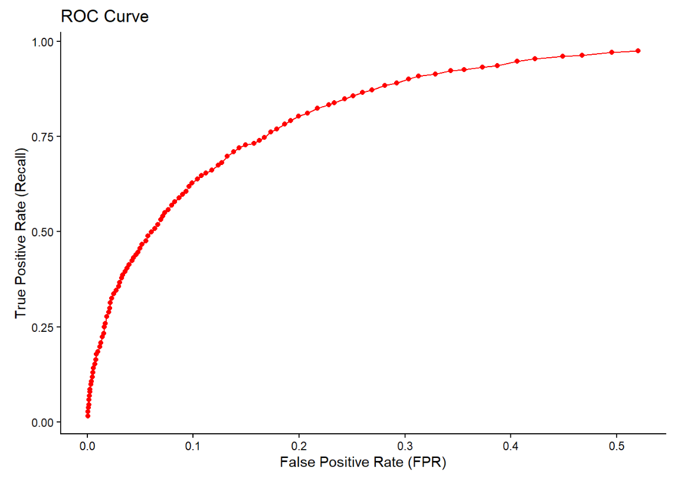
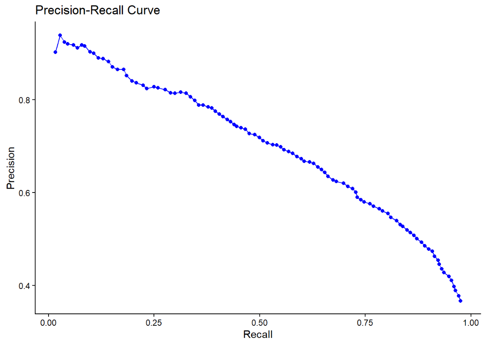

# m6APrediction

**An R Package for Predicting RNA m6A Modification Sites Using Random Forest**

## Overview

m6APrediction is an R package designed to predict N6-methyladenosine (m6A) modification sites in RNA using a trained random forest classification model.

m6A is an important RNA modification involved in regulating RNA stability, splicing, translation, and other biological processes. Identifying potential m6A sites can help researchers investigate post-transcriptional gene regulation.

This package provides functions for predicting m6A modification probabilities from sequence and biological features. It supports both individual-site prediction and batch prediction.

## Installation

The package can be installed directly from GitHub:

```r
install.packages("remotes")
remotes::install_github("YOUR_USERNAME/m6APrediction")
```

Replace `YOUR_USERNAME` with the GitHub username of the repository owner.

Load the package:

```r
library(m6APrediction)
```

## Main Functions

The package contains three functions:

- `dna_encoding()`: Converts DNA sequences into categorical nucleotide features.
- `prediction_multiple()`: Predicts m6A probabilities and classification statuses for multiple input sequences.
- `prediction_single()`: Predicts the m6A probability and classification status for an individual site.

## Usage Examples

### 1. Predicting Multiple m6A Sites

Load the trained random forest model and example dataset:

```r
library(m6APrediction)

ml_fit <- readRDS(
  system.file("extdata", "rf_fit.rds",
              package = "m6APrediction")
)

example_df <- read.csv(
  system.file("extdata", "m6A_input_example.csv",
              package = "m6APrediction")
)
```

Run batch prediction:

```r
multiple_results <- prediction_multiple(
  ml_fit,
  example_df,
  positive_threshold = 0.6
)

head(multiple_results)
```

The function returns the original input features together with `predicted_m6A_prob` and `predicted_m6A_status`.

### 2. Predicting a Single m6A Site

```r
single_result <- prediction_single(
  ml_fit,
  gc_content = 0.6,
  RNA_type = "mRNA",
  RNA_region = "CDS",
  exon_length = 12,
  distance_to_junction = 5,
  evolutionary_conservation = 0.8,
  DNA_5mer = "GGACA",
  positive_threshold = 0.5
)

print(single_result)
```

The function returns the predicted probability and classification status for the input site.

## Model Performance

The model is based on a random forest classifier. ROC and Precision–Recall curves generated during the earlier practical demonstrate its classification performance.

### Receiver Operating Characteristic (ROC) Curve



The ROC curve illustrates the relationship between the true positive rate and false positive rate across classification thresholds.

### Precision–Recall Curve (PRC)



The Precision–Recall curve illustrates the trade-off between precision and recall across classification thresholds. This evaluation is particularly useful when identifying positive modification sites.

Together, these curves help assess the model's ability to distinguish potential m6A modification sites from negative sites.

## Scientific Significance

Computational prediction of m6A modification sites provides a useful approach for prioritising candidate RNA modification sites for further investigation.

By integrating nucleotide sequence information with biological features, m6APrediction enables individual and batch predictions. Its probability outputs allow users to apply different classification thresholds depending on their analytical needs.

These predictions can support exploratory RNA modification research, although experimental validation remains necessary to confirm predicted modification sites.

## License

MIT License.
